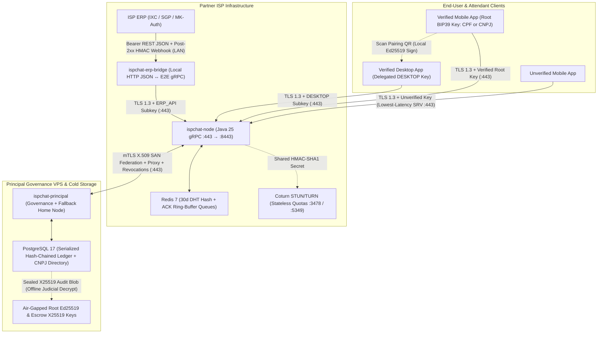

# ISP Chat Dual-Tier Identity Governance, Chain-of-Trust Verification, Corporate ERP Gateway, and Home-Node Routing

* **Author:** Ruy / Antigravity
* **Status:** Approved for Implementation (Resolved via `/egm-review` & `/egm-resolve`)
* **Date:** 2026-11-12

--------------------------------------------------------------------------------

## Overview

ISP Chat is a federated, end-to-end encrypted (E2E) text, voice, and video communication network operated by participating Internet Service Providers (ISPs) alongside a Root Governance Principal Server (`ispchat-principal`). It provides ISPs with a zero-per-message-fee communication channel with their subscribers across Mobile (Android/iOS), Desktop, and ISP ERP integrations while operating as an everyday E2E messenger among end users.

This design evolves the existing single-key MVP (`node/` in Java 25 LTS and `app/` in Flutter) into a governed dual-tier system:

1. **Unverified Tier:** Open mobile onboarding to preserve household and social network adoption, constrained by protocol-level capability limits (`1` active concurrent stream, `0` delegated sub-device keys, bounded rate limits, and zero public directory listing).
2. **Verified Tier (CPF or CNPJ):** Accounts verified through a four-level cryptographic Chain of Trust (`Root Governance -> Partner ISP CNPJ & Managing Partners -> Collaborator CPF -> Subscriber CPF or Corporate CNPJ`), unlocking an offline-verifiable Verified badge, QR-Code Desktop pairing, `ERP_API` subkey delegation, and signed Home-Node portability across participating ISPs.

## The Problem

Regional and national ISPs rely on WhatsApp Business for billing notifications, outage alerts, technical support, and contract management. That platform charges businesses per conversation template while remaining free to end users, turning subscriber support into a recurring per-conversation operating cost controlled by a single external vendor.

Deploying the current ISP Chat repository on public VPS infrastructure as a WhatsApp alternative fails for five technical reasons:

1. **No Governance or Corporate Account Model:** Every user generates an unverified 12-word BIP39 seed locally (`identity_crypto_service.dart`). No mechanism binds an account to a verified CPF or CNPJ, displays a cryptographically verifiable badge, operates an official ISP corporate account across multiple Desktop attendants, or connects an ISP ERP (IXC, SGP, MK-Auth) via HTTP JSON and webhooks without terminating E2E encryption.
2. **Fraud Accountability vs. Competitor Subscriber Scraping:** When an ISP validates identity documents, the network needs tamper-evident accountability proving which Collaborator (`CPF`) at which ISP (`CNPJ` and Managing Partners) attested that user. Storing plaintext CPFs with online decryption keys or exposing CPF lookups on a shared server would allow a Principal VPS breach or a competing ISP to enumerate another provider's subscriber base (commercial and LGPD exposure).
3. **Single-Key E2E Blocks Safe Desktop Pairing and Per-Device Offline Delivery:** The current protocol (`CryptoService.java` and `identity_crypto_service.dart`) binds each `UUIDv7` to a single static keypair, omits `receiver_uuid` on `ServerEnvelope`, leaves `MOBILE_ROOT` `X25519` session keys unsigned in DHT records, and drains Redis queues in `OfflineMessageQueueService.java` via an unacknowledged destructive `LPOP` loop. Pairing a Desktop or ERP gateway would either expose the mobile root private key or cause the first connected device to delete queued messages before sibling devices receive them.
4. **Cross-ISP Offline Queue Isolation:** When a recipient has no active stream in the sender node's ephemeral in-memory `DhtStoreService`, `MessageRouterService.java` enqueues `TEXT` messages in the **sender node's** local Redis. When the recipient later connects to their own ISP's node, those messages remain isolated on the sender's node.
5. **VPS Deployment & Media Wiring Gaps:** `node/docker-compose.yml` sets `ISPCHAT_NODE_ID` while `KademliaRoutingTable.java` reads `ISPCHAT_DHT_NODE_ID`, causing nodes to boot with colliding IDs. `node/Dockerfile` switches to non-root `USER ispchat` while attempting to bind privileged port `443` directly, and `node/turnserver.conf` allocates only 101 UDP ports (`49152-49252`) with zero per-user relay quotas. On the client, `node_discovery_service.dart` lacks DNS SRV resolution (`_ispchat._tcp.ispchat.dev.br`), and `webrtc_call_coordinator.dart` exchanges signaling JSON without binding `flutter_webrtc` `RTCPeerConnection` media tracks or Coturn TURN credentials.

## Goals

* **Enforce Measurable Dual-Tier Protocol Capabilities:** Restrict Unverified accounts at the gRPC boundary (`ClientStreamGrpcService`, `DhtClientGrpcService`, and `TurnCredentialGrpcService`) to at most `1` concurrent active stream, `0` delegated device subkeys, `10` outgoing messages/minute, `20` distinct new recipients/24h, and `600s` TURN credentials (`5` issuances/hour) under Coturn's server-enforced `512 kbps` (`max-bps=64000`) relay cap. Grant Verified accounts offline-verifiable `90-day` `VerificationCredential` tokens, up to `5` active devices for Verified `CPF` (`MOBILE_ROOT` + up to `4` `DESKTOP` subkeys) and `10` active devices for Verified `CNPJ` (`MOBILE_ROOT` + up to `9` `DESKTOP`/`ERP_API` subkeys), `3600s` TURN credentials, and configurable corporate throughput (`600` messages/minute default per Verified `CNPJ`).
* **Establish Cryptographic Accountability Without CPF Enumeration:** Record an append-only, serialized SHA-256 hash-chained ledger on `ispchat-principal` capturing the four-level `Ed25519` Chain of Trust (`Root -> ISP CNPJ + Partners -> Collaborator CPF -> User CPF/CNPJ + UUIDv7`). Enforce `1 CPF = 1 active Verified UUIDv7` via memory-hard `Argon2id` (`64 MiB`) + keyed `HMAC-SHA256` blind indexing (`BlindIndexService`) gated by fresh subscriber mobile consent signatures, seal plaintext audit records under an air-gapped Root Escrow `X25519` public key, and publish only Verified `CNPJ` entries in the searchable directory.
* **Keep Real-Time Traffic Independent of Principal Server Uptime:** Validate `VerificationCredential` tokens locally in memory against `PrincipalSigningCert` (anchored to the pinned Level-0 Root `Ed25519` public key) and route live Unverified and Verified streams directly across Partner ISP nodes without synchronous Principal RPCs on messaging or call hot paths.
* **Enable Multi-Device E2E & Local ISP ERP Integration:** Support QR-Code pairing (`DeviceDelegationCert`) under a single universal BIP39 root-key model for both `CPF` and `CNPJ` accounts, per-device `X25519` content-key wrapping, and a self-hosted `ispchat-erp-bridge` sidecar inside the ISP's private LAN exposing REST JSON and post-`2xx` acknowledged webhooks to IXC, SGP, and MK-Auth.
* **Deliver Cross-ISP Offline Messages & Signed Portability:** Route undelivered `TEXT` envelopes over mTLS to the recipient's verified `HomeNodeClaim` (Partner ISP Node or Principal Fallback Node), replace destructive `LPOP` with per-device cursor/ACKed Redis ring-buffer queues (`1,000` messages cap, `7-day` TTL), and support mobile-signed Home-Node portability (`max_hops = 2` redirects) plus Collaborator-signed immediate (`0h`) CPF Re-Binding (`UUIDv7` rotation) on lost devices.
* **Deliver Deployable VPS Containers & Functional WebRTC Calls:** Structure `node/` into four sibling Gradle subprojects (`:ispchat-common`, `:ispchat-node`, `:ispchat-principal`, `:ispchat-erp-bridge`), migrate Flutter wire serialization to `protoc`-generated stubs, fix container port (`443:8443`) and `ISPCHAT_DHT_NODE_ID` configuration, implement DNS-over-HTTPS SRV discovery, configure native OS permissions/entitlements, and wire `flutter_webrtc` audio/video calls with Coturn `use-auth-secret` TURN credentials.

## Non-Goals

* **Server-Side Private Key Custody:** Neither `ispchat-node` nor `ispchat-principal` generates, stores, or backs up user or corporate `Ed25519`/`X25519` private keys. Losing both a root mobile device and its 12-word BIP39 recovery phrase permanently prevents decryption of historical E2E ciphertext.
* **Public CPF Search or Reverse Lookup:** End users, Collaborators, and Partner ISPs cannot search, list, or enumerate Verified individual accounts by `CPF` without a fresh cryptographic consent signature from the target user's mobile device.
* **Mandatory Proprietary OS Hardware Attestation:** Google Play Integrity and Apple App Attest are excluded so the GPLv3 client remains independent of proprietary mobile app stores and runs on custom Android distributions.
* **Deferred Roadmap Phases:** Large-group chat via Apache Kafka, automated BGP Anycast / Registro.br secondary DNS election, CDN Domain Fronting, and Bluetooth LE / Wi-Fi Direct local mesh remain out of scope for this specification.

## Open Questions

None at this stage.

## Critical User Journeys (CUJs)

### CUJ 1: Unverified Household Member Joins on Mobile

* **Given**: A family member living in a subscriber's home installs the Flutter mobile app without holding an ISP broadband contract in their own CPF.
* **When**: The app resolves `_ispchat._tcp.ispchat.dev.br` via DNS-over-HTTPS SRV, connects to the lowest-latency reachable ISP node (signing a default `HomeNodeClaim` at `routing_epoch = 0` pointing to the Principal Fallback Node for offline storage), generates a 12-word BIP39 identity locally, and opens `ClientStreamService.Connect`.
* **Then**: The user exchanges E2E text messages and WebRTC calls on mobile with an explicit "Unverified" indicator shown to peers; opening a second concurrent stream or exceeding rate limits is rejected with `RESOURCE_EXHAUSTED`, and submitting any `DeviceDelegationCert` is rejected with `PERMISSION_DENIED`.

### CUJ 2: ISP Collaborator Verifies a Subscriber Under the Chain of Trust

* **Given**: Partner ISP `CNPJ` (whose corporate root BIP39 key resides on an ISP Admin mobile device) and its Managing Partners (`CPF`) are registered on `ispchat-principal`, and a Managing Partner's Verified mobile has signed a `CollaboratorAuthCert` for Collaborator Ana (`CPF`). Subscriber Carlos has generated his mobile identity (`UUIDv7`) and requests Verified status.
* **When**: Carlos approves a verification consent prompt on his mobile app (signing `ISPCHAT-VERIFY-REQ-V1` and sharing `ispchat://verify-req?...` via QR Code or E2E chat), and Collaborator Ana validates Carlos's government ID, signs `UserVerificationAttestation`, and calls `PrincipalGovernanceService.SubmitVerification` on the Partner ISP Node, which proxies the request over mTLS to `ispchat-principal`.
* **Then**: `ispchat-principal` verifies the Partner ISP's mTLS X.509 SAN against `verified_isps.node_address`, validates the four-level signature chain (`Root -> ISP/Partner -> Ana CPF -> Carlos consent`), checks `BlindIndexService` (`Argon2id` + `HMAC-SHA256`) uniqueness, seals the plaintext CPF chain under the air-gapped Root Escrow `X25519` public key in `verification_audit_ledger`, issues a Principal-signed `HomeNodeClaim` (`ISP Node`) and `90-day` `VerificationCredential`, and makes both retrievable by Carlos's mobile via `GetOrRenewCredential`.

### CUJ 3: Verified User Pairs Desktop App via QR Code

* **Given**: Carlos holds an active `VerificationCredential` on his mobile phone and opens the ISP Chat Desktop app on his workstation.
* **When**: The Desktop app generates a dedicated `(device_ed25519, device_x25519)` keypair and renders a `120s`-bounded `ispchat://pair?...` QR Code via `qr_flutter`; Carlos scans the QR Code with his Verified mobile camera (`mobile_scanner`) and confirms pairing.
* **Then**: Carlos's mobile signs a `DeviceDelegationCert` (`role = DESKTOP`) locally without transmitting its BIP39 seed or root private keys, registers the updated `(user_uuid, device_id)` session in DHT, and both devices independently encrypt, decrypt, synchronize sent messages, and acknowledge queued messages via `DELIVERY_ACK`.

### CUJ 4: ISP Corporate Account Automates Billing & Support via ERP Bridge and Desktop

* **Given**: Partner ISP holds a Verified `CNPJ` corporate account published in `DirectoryService.SearchVerifiedCnpj` (with its root `Ed25519`/`X25519` public keys), pairs `ispchat-erp-bridge` (`--print-pairing-uri`) with an `ERP_API` `DeviceDelegationCert` signed by the ISP Admin mobile, and pairs attendant Desktop workstations with `DESKTOP` `DeviceDelegationCert`s (up to `10` total devices).
* **When**: The ISP's ERP (IXC, SGP, or MK-Auth) POSTs an invoice JSON payload to `ispchat-erp-bridge` (`127.0.0.1:8090`), and Subscriber Carlos (receiving a first-contact message from that Verified `CNPJ`) replies from his mobile phone asking for technical support.
* **Then**: `ispchat-erp-bridge` encrypts the invoice E2E to Carlos's active device `X25519` keys over TLS 1.3 gRPC (`:443`) without queuing redundant offline copies for corporate sibling workstations; Carlos's app accepts the authenticated first-contact message with the ISP's Verified `CNPJ` badge, and his E2E reply arrives at paired support Desktop apps and at `ispchat-erp-bridge`, which withholds `DELIVERY_ACK` until the ERP webhook returns HTTP `2xx`.

### CUJ 5: Cross-ISP Offline Messaging and Signed Subscriber Portability

* **Given**: Verified Subscriber Carlos (hosted on ISP A) is offline while Alice (hosted on ISP B) sends him an E2E `TEXT` message; later, Carlos cancels ISP A and migrates to participating ISP B (or to the Principal Fallback Node).
* **When**: ISP B's node resolves Carlos's `HomeNodeClaim` (`ISP A`) and forwards Alice's encrypted envelope over mTLS `NodeRoutingService.RoutePayload` to ISP A's Redis queue (returning `SERVER_QUEUED_ACK` to Alice); upon reconnecting, Carlos receives and ACKs the message (`DELIVERY_ACK`). Later, Carlos signs a portability request (`routing_epoch + 1`) migrating his `HomeNodeClaim` from ISP A to ISP B (co-signed by an ISP B Collaborator) or to the Principal Fallback Node (signed by Carlos alone).
* **Then**: Carlos retains the same `UUIDv7`, contact graph, and E2E history while ISP A writes a `30-day` redirect tombstone forwarding in-flight envelopes (`hop_count <= 2`) to Carlos's new Home Node.

### CUJ 6: Lost-Device Verified CPF Re-Binding with Immediate Accountability

* **Given**: Carlos loses his phone without his 12 BIP39 words, installs ISP Chat on a new phone (generating `UUIDv7_new`), and presents government photo ID to a Verified ISP Collaborator.
* **When**: Carlos signs `ISPCHAT-VERIFY-REQ-V1` on his new phone and the Collaborator signs and submits `SubmitCpfRebind` through the Partner ISP Node's mTLS proxy to `ispchat-principal`.
* **Then**: Within one PostgreSQL transaction, `ispchat-principal` appends the Collaborator `CPF` and ISP `CNPJ` accountability record to `verification_audit_ledger`, marks `UUIDv7_old` `REVOKED`, inserts `UUIDv7_old` + Principal-signed `IdentityReplacementNotice` (`UUIDv7_old -> UUIDv7_new`) into `credential_revocations`, and binds the active `doc_blind_index` to `UUIDv7_new` (`0h` hold); post-commit, `StreamRevocations` pushes the revocation to all ISP nodes, immediately closing `UUIDv7_old`'s active streams with `REVOCATION_NOTICE` and notifying peers via `IDENTITY_REPLACED`.

## Technical Plan (Architecture)

### 1. System Topology & Module Boundaries

To keep Partner ISP nodes free of PostgreSQL and HTTP server dependencies while composing the Principal Fallback Home Node without code duplication, the Java 25 LTS Gradle workspace (`node/`, root project `"ispchat-backend"`) is organized into four sibling subprojects alongside the Flutter client (`app/`):

* **`:ispchat-common` (`node/ispchat-common/`):** Shared `java-library` exposing (`api`) `protoc`-generated Protobuf/gRPC stubs (`ispchat.proto`), `CanonicalTranscripts` binary builders, `Ed25519`/`X25519`/`ChaCha20-Poly1305` JCA helpers, `Argon2id` + `HMAC-SHA256` primitives (`bcprov-jdk18on`), and RFC 9562 `UUIDv7` utilities (`com.github.f4b6a3:uuid-creator:6.0.0`).
* **`:ispchat-node` (`node/ispchat-node/`):** Headless Netty gRPC server (`port 8443` in container, published as `443:8443/tcp`) deployed by participating ISPs alongside `redis:7-alpine` and stateless `coturn/coturn`. Enforces dual-tier capabilities, mTLS SAN federation, Kademlia DHT `(user_uuid, device_id)` session and `HomeNodeClaim` storage, per-device ACKed ring-buffer queues, Coturn `use-auth-secret` credential issuance, and `@ConditionalOnMissingBean` edge-to-Principal proxy services (`EdgeGovernanceProxyGrpcService`, `EdgeDirectoryProxyGrpcService`). Produces both a runnable `bootJar` and a plain library `jar`.
* **`:ispchat-principal` (`node/ispchat-principal/`):** Governance and Principal Fallback Home Node service deployed on the Principal VPS alongside `postgres:17-alpine` (Flyway) and `redis:7-alpine` + `coturn/coturn`. Depends directly on `implementation(project(":ispchat-node"))` so `GrpcServerRunner` auto-binds 100% of Fallback Home-Node services alongside primary `PrincipalGovernanceGrpcService` and `DirectoryGrpcService` beans (superseding `:ispchat-node`'s `@ConditionalOnMissingBean` proxies). Also ships `OfflineGovernanceCli` for air-gapped Level-0 Root signing and lawful escrow decryption.
* **`:ispchat-erp-bridge` (`node/ispchat-erp-bridge/`):** Spring Web HTTP-to-gRPC sidecar deployed inside a Partner ISP's private LAN (`127.0.0.1:8090` default). Pairs via `--print-pairing-uri` using an `ERP_API` `DeviceDelegationCert` signed by the ISP's corporate root mobile key, connects to the ISP's local `ispchat-node` over a dedicated TLS 1.3 `ManagedChannel` trusting `ca.crt`, and translates adapter-neutral REST JSON and webhooks for IXC, SGP, and MK-Auth.
* **`app/` (Flutter Mobile & Desktop):** Multi-platform client targeting Android, iOS, macOS, Windows, and Linux using `protoc_plugin` (`25.0.0`) generated stubs, `cryptography`, `flutter_webrtc`, `mobile_scanner` (guarded to Android/iOS), and `qr_flutter`.



### 2. Cryptographic Chain of Trust, Canonical Transcripts & Offline Audit Escrow

Deterministic identity derivation maps any raw 32-byte `Ed25519` public key to an RFC 9562 `UUIDv7` as already implemented in `CryptoService.deriveIdentityUuidV7` (SHA-256 of the 32-byte public key with version `0x7` and IETF variant bits). Document strings are normalized prior to hashing or blind indexing by stripping formatting punctuation (`.`, `-`, `/`, whitespace): `CPF` requires exactly `11` ASCII digits (`[0-9]{11}` with valid Modulo-11 check digits), and `CNPJ` requires `14` uppercase ASCII alphanumeric characters (`[0-9A-Z]{12}[0-9]{2}` per Receita Federal IN RFB 2229/2024 with Modulo-11 check digits).

All V2 signatures use raw 32-byte `Ed25519` keys over length-prefixed binary transcripts (`UTF8(DOMAIN_TAG) || [uint32_be(field_byte_len) || field_bytes]...`), where `UUID` strings encode as 36-byte lowercase ASCII, `int64` timestamps/epochs encode as 8-byte `int64_be`, Protobuf enums encode as 4-byte `uint32_be`, and public keys/hashes encode as raw 32-byte arrays:

| Domain Tag | Signer Key | Ordered Transcript Fields | Purpose & TTL / Freshness |
| :--- | :--- | :--- | :--- |
| `ISPCHAT-ROOT-PRIN-V1` | Level-0 Root `Ed25519` (offline) | `cert_id`, `principal_ed25519_pub`, `escrow_x25519_pub`, `issued_at_ms`, `expires_at_ms` | Certifies online `PrincipalSigningCert` (`1-year` TTL) verified against pinned Root key. |
| `ISPCHAT-CHAIN-ISP-V1` | Level-0 Root `Ed25519` (offline) | `isp_cnpj`, `trade_name`, `corporate_uuid`, `corp_root_ed25519_pub`, `corp_root_x25519_pub`, `node_address`, `partners_digest_sha256`, `issued_at_ms` | Bootstraps Partner ISP corporate account and Managing Partners via `RegisterPartnerIsp`. |
| `ISPCHAT-CHAIN-COLLAB-V1` | Managing Partner `Ed25519` | `cert_id`, `isp_cnpj`, `partner_uuid`, `collaborator_uuid`, `collab_cpf_sha256`, `collab_ed25519_pub`, `issued_at_ms`, `expires_at_ms` | Authorizes a Collaborator (`max 1-year` TTL) under `isp_cnpj`. |
| `ISPCHAT-VERIFY-REQ-V1` | Target User Root `Ed25519` | `user_uuid`, `user_ed25519_pub`, `user_x25519_pub`, `doc_type`, `doc_sha256`, `isp_cnpj`, `timestamp_ms` | Subscriber consent (`[server_now - 300s, server_now + 300s]`) carried in `ispchat://verify-req?...`. |
| `ISPCHAT-CHAIN-USER-V1` | Collaborator `Ed25519` | `isp_cnpj`, `collaborator_uuid`, `user_uuid`, `doc_type`, `doc_sha256`, `home_node_address`, `consent_signature`, `attested_at_ms` | Collaborator attestation for `SubmitVerification`. |
| `ISPCHAT-REBIND-V1` | Collaborator `Ed25519` | `isp_cnpj`, `collaborator_uuid`, `old_user_uuid`, `new_user_uuid`, `doc_sha256`, `home_node_address`, `new_consent_signature`, `attested_at_ms` | Immediate (`0h`) lost-device CPF rotation (`SubmitCpfRebind`). |
| `ISPCHAT-CRED-V1` | Online Principal `Ed25519` | `credential_id`, `user_uuid`, `root_ed25519_pub`, `root_x25519_pub`, `doc_type`, `public_cnpj`, `public_display_name`, `verifying_isp_cnpj`, `verifying_isp_name`, `home_node_address`, `routing_epoch`, `issued_at_ms`, `expires_at_ms` | Self-contained `VerificationCredential` (`90-day` TTL, renewed at `60 days`). |
| `ISPCHAT-DELEGATE-V1` | Account Root `Ed25519` | `cert_id`, `user_uuid`, `device_id`, `role`, `device_ed25519_pub`, `device_x25519_pub`, `issued_at_ms`, `expires_at_ms` | Delegates `DESKTOP` or `ERP_API` subkey (`max 90-day` TTL) without sharing BIP39 seed. |
| `ISPCHAT-DHT-V2` | Active Device `Ed25519` | `user_uuid`, `device_id`, `node_address`, `root_ed25519_pub`, `device_ed25519_pub`, `device_x25519_pub`, `timestamp_ms` | Authenticates DHT session record and binds `device_x25519_pub` against DHT MitM. |
| `ISPCHAT-HOME-V1` | Principal or User `Ed25519` | `user_uuid`, `home_node_address`, `routing_epoch`, `issued_at_ms` | `principal_signature` required for Partner ISP nodes; `user_signature` allowed only for Fallback Node (`epoch = 0`). |
| `ISPCHAT-REPLACE-V1` | Online Principal `Ed25519` | `revocation_id`, `old_user_uuid`, `new_user_uuid`, `verifying_isp_cnpj`, `replaced_at_ms` | `IdentityReplacementNotice` notifying peers of audited CPF key rotation. |
| `ISPCHAT-REVOKE-V1` | Online Principal `Ed25519` | `revocation_id`, `revocation_seq`, `target_uuid`, `revoked_device_id`, `reason`, `created_at_ms` | Authenticates `RevocationEvent` entries and `REVOCATION_NOTICE` control frames. |
| `ISPCHAT-MSG-V2` | Active Device `Ed25519` | `message_id`, `sender_uuid`, `sender_device_id`, `receiver_uuid`, `message_type`, `ref_message_id`, `encrypted_payload_bytes`, `timestamp_ms` | Authenticates V2 `ClientEnvelope` / `ServerEnvelope` frames across root and delegated devices. |
| `ISPCHAT-LEDGER-ROW-V1` | SHA-256 Input Only | `seq`, `entry_id`, `action_type`, `target_uuid`, `doc_blind_index`, `isp_cnpj`, `collaborator_uuid`, `ephemeral_x25519_pub`, `sealed_audit_blob`, `created_at_epoch_ms` | Deterministic `canonical_row_bytes` hashed as `SHA256(prev_entry_hash \|\| canonical_row_bytes)`. |

1. **Zero Server-Side `Ed25519` Custody & mTLS SAN Origin Binding:** Partner ISP nodes hold zero `isp_ed25519` private keys. Instead, `MtlsFederationInterceptor` extracts the CA-verified X.509 client certificate `subjectAltName` (`DNS` or `IP`) on every federated call to `ispchat-principal`, which verifies that Collaborator governance RPCs arrive from the mTLS peer matching `verified_isps.node_address`.
2. **Memory-Hard Blind Indexing (`BlindIndexService`):** On Collaborator/Partner registration and user verification (`< 10 req/s`, never on message routing), `ispchat-principal` computes `doc_blind_index = HMAC-SHA256(principal_pepper, Argon2id(input = UTF8("ISPCHAT-DOC-V1:" || doc_type || ":" || normalized_doc), salt = SHA256(principal_pepper || ":blind-salt"), m = 65536 KiB, t = 3, p = 1))` gated by a `Semaphore(4)` (`256 MiB` peak RAM, `~80 ms` latency; `~3.2 CPU-years` and `64 PB-rounds` to brute-force $10^9$ CPFs offline).
3. **Asymmetric Audit Escrow Sealing:** `AuditLedgerService` serializes the plaintext accountability JSON (`user_doc`, `user_uuid`, `collaborator_cpf`, `collaborator_uuid`, `isp_cnpj`, `partner_uuids`, and raw `Ed25519` signatures), generates an ephemeral `X25519` keypair `(eph_priv, eph_pub)`, derives `seal_key = HKDF-SHA256(ikm = X25519(eph_priv, escrow_x25519_pub), salt = eph_pub || escrow_x25519_pub, info = UTF8("ISPCHAT-AUDIT-ESCROW-V1"), len = 32)`, and encrypts the JSON with `ChaCha20-Poly1305` packed as `[nonce(12) || ciphertext || tag(16)]` (`aad = prev_entry_hash`). Only `OfflineGovernanceCli` on an air-gapped machine holding `escrow_x25519_priv` can decrypt `sealed_audit_blob` for lawful audit decryption under judicial order.

| `PrincipalGovernanceService` RPC | Client Path | Required Cryptographic Proof | Effect |
| :--- | :--- | :--- | :--- |
| `RegisterPartnerIsp` | Admin CLI -> Principal | `ISPCHAT-CHAIN-ISP-V1` signed by Level-0 Root `Ed25519` | Upserts `verified_isps`, `isp_managing_partners`, and initial corporate `CNPJ` + Partner `CPF` `verified_accounts` rows. |
| `AuthorizeCollaborator` | Partner Mobile -> Edge Proxy -> Principal | mTLS SAN == `isp.node_address` + Managing Partner `ISPCHAT-CHAIN-COLLAB-V1` sig | Inserts/updates `verified_collaborators` and logs audit entry. |
| `RevokeCollaborator` | Partner Mobile -> Edge Proxy -> Principal | mTLS SAN == `isp.node_address` + Managing Partner `Ed25519` sig | Sets `revoked_at`, appends `credential_revocations`, and logs audit entry. |
| `SubmitVerification` | Collab App -> Edge Proxy -> Principal | mTLS SAN == `isp.node_address` + active `CollaboratorAuthCert` + fresh `ISPCHAT-VERIFY-REQ-V1` + `ISPCHAT-CHAIN-USER-V1` | Enforces active `doc_blind_index` uniqueness, appends sealed ledger row, issues `VerificationCredential` + `HomeNodeClaim`. |
| `SubmitCpfRebind` | Collab App -> Edge Proxy -> Principal | mTLS SAN == `isp.node_address` + active `CollaboratorAuthCert` + fresh `UUIDv7_new` `ISPCHAT-VERIFY-REQ-V1` + `ISPCHAT-REBIND-V1` | Revokes `UUIDv7_old` (`0h` hold), records `IdentityReplacementNotice`, binds `UUIDv7_new`, logs sealed ledger row. |
| `GetOrRenewCredential` | Verified Client -> Edge Proxy -> Principal | Caller `Ed25519` challenge sig (`user_uuid` or delegated `device_id`) | Returns current `VerificationCredential` + `HomeNodeClaim`, or re-issues `90-day` credential when non-revoked and within `30 days` of expiry. |
| `RevokeDevice` | Root Mobile -> Edge Proxy -> Principal | Account Root `Ed25519` signature over `(user_uuid, revoked_device_id, ts)` | Appends `(user_uuid, revoked_device_id)` to `credential_revocations` -> closes active stream via `StreamRevocations`. |
| `PortAccount` | Root Mobile -> Edge Proxy -> Principal | Root `Ed25519` sig (+ target ISP Collab sig + mTLS SAN when porting to a Partner ISP; Root sig alone when porting to Fallback Node) | Increments `routing_epoch`, issues updated `VerificationCredential` + `HomeNodeClaim`, writes `30d` redirect on prior Home Node. |
| `StreamRevocations` | `ispchat-node` -> Principal | CA-verified mTLS peer X.509 certificate | Streams `RevocationEvent` records (`revocation_seq > since_seq`) including `replacement_notice_bytes`. |

### 3. PostgreSQL 17 Entities & Key Invariants on `ispchat-principal`

Managed via Flyway (`V1__init_principal_governance.sql`), every table uses an application-generated `UUIDv7` (`uuid-creator`) as its `PRIMARY KEY`:

| Table | Primary Key (`UUIDv7`) | Core Columns & Purpose | Enforced Database & Concurrency Invariants |
| :--- | :--- | :--- | :--- |
| `verified_isps` | `id UUID PRIMARY KEY` | `cnpj` (`14` chars), `trade_name`, `corporate_uuid`, `node_address`, `status`, `created_at` | `UNIQUE(cnpj)`, `UNIQUE(corporate_uuid)`, `UNIQUE(node_address)` (binds mTLS SAN). |
| `isp_managing_partners` | `id UUID PRIMARY KEY` | `isp_id` (FK), `partner_uuid`, `cpf_blind_index`, `partner_ed25519_pub`, `active` | `UNIQUE(isp_id, partner_uuid)`; authorizes `AuthorizeCollaborator` and `RevokeCollaborator`. |
| `verified_collaborators` | `id UUID PRIMARY KEY` | `isp_id` (FK), `collaborator_uuid`, `cpf_blind_index`, `collaborator_ed25519_pub`, `authorized_by_partner_uuid`, `cert_bytes`, `expires_at`, `revoked_at` | `UNIQUE(collaborator_uuid)`; rejected at verification if `revoked_at IS NOT NULL` or `expires_at <= now()`. |
| `verified_accounts` | `id UUID PRIMARY KEY` | `user_uuid`, `doc_type`, `doc_blind_index`, `root_ed25519_pub`, `root_x25519_pub`, `public_cnpj`, `public_display_name`, `verifying_isp_id`, `home_node_address`, `routing_epoch`, `credential_bytes`, `home_claim_bytes`, `status`, `updated_at` | `UNIQUE(user_uuid)` and partial unique index `UNIQUE(doc_blind_index) WHERE status = 'ACTIVE'` so historical `REVOKED` rows coexist cleanly with re-bound `UUIDv7_new` rows. |
| `verification_audit_ledger` | `entry_id UUID PRIMARY KEY` | `seq BIGINT GENERATED ALWAYS AS IDENTITY UNIQUE`, `action_type`, `target_uuid`, `doc_blind_index`, `isp_cnpj`, `collaborator_uuid`, `ephemeral_x25519_pub`, `sealed_audit_blob`, `prev_entry_hash`, `entry_hash`, `created_at` | Serialized via `SELECT pg_advisory_xact_lock(8443001)` inside the insert transaction plus `UNIQUE(prev_entry_hash)` (genesis `prev_entry_hash = 32 zero bytes`), preventing concurrent hash-chain forks. |
| `credential_revocations` | `revocation_id UUID PRIMARY KEY` | `revocation_seq BIGINT GENERATED ALWAYS AS IDENTITY UNIQUE`, `target_uuid`, `revoked_device_id` (nullable), `reason`, `principal_signature`, `replacement_notice_bytes` (nullable), `created_at` | Monotonic `revocation_seq` cursor feeds `StreamRevocations` without gaps; `replacement_notice_bytes` carries `IdentityReplacementNotice` on `CPF_REBIND`. |

### 4. Dual-Tier Enforcement, Universal Corporate Root Delegation & Multi-Device E2E

1. **Capability & Sybil Enforcement (`ClientStreamGrpcService`, `DhtClientGrpcService`, `TierRateLimiterService`):**
   * **Per-Network Prefix Guard:** Before stream registration, Redis sliding windows cap each `/32` IPv4 address and `/64` IPv6 prefix at `30` `AUTH_HANDSHAKE` attempts/minute and `10` new Unverified session registrations/hour (`RESOURCE_EXHAUSTED`).
   * **Unverified Handshake (`VerificationCredential` absent):** Node validates `deriveIdentityUuidV7(sender_public_key) == sender_uuid` and `device_id == sender_uuid`. Any `DeviceDelegationCert` returns `PERMISSION_DENIED`. If an active keepalive-responsive stream already exists for `sender_uuid`, a second concurrent `Connect` is deterministically rejected with `RESOURCE_EXHAUSTED` (stale half-open sockets failing keepalive are closed first). Redis enforces `10` outgoing messages/min (token bucket) and `20` distinct new recipients/24h (rolling HyperLogLog/Set; `RESOURCE_EXHAUSTED`).
   * **Verified Handshake (`VerificationCredential` present):** Node validates `PrincipalSigningCert` against the pinned Level-0 Root `Ed25519` key, verifies `VerificationCredential` (`expires_at > now`), and checks local Redis revocation keys (`ispchat:revoked:uuid:<user_uuid>` and `ispchat:revoked:device:<device_id>`, returning `PERMISSION_DENIED` if revoked). Secondary devices (`DESKTOP` or `ERP_API`) must present a `DeviceDelegationCert` signed by `VerificationCredential.root_ed25519_pub` (`PERMISSION_DENIED` on mismatch), capped at `5` active devices for `CPF` and `10` active devices for `CNPJ` (`RESOURCE_EXHAUSTED` when exceeded).
2. **Universal BIP39 Root Delegation (`CPF` & `CNPJ`):**
   * Both individual (`CPF`) and corporate (`CNPJ`) accounts derive `user_uuid = deriveIdentityUuidV7(root_ed25519_pub)` from a 12-word BIP39 seed held exclusively on a mobile device (for an ISP `CNPJ`, the ISP Admin mobile).
   * Desktop workstations render `ispchat://pair?device_id=<u7>&ed25519=<b64url>&x25519=<b64url>&role=DESKTOP&ts=<ms>`, while headless `ispchat-erp-bridge --print-pairing-uri` logs `role=ERP_API`. The Verified mobile checks `ts` within `[mobile_now - 120s, mobile_now + 120s]`, signs `DeviceDelegationCert` (`ISPCHAT-DELEGATE-V1`), and registers the delegated session via `DhtClientService.RegisterSession`.
   * `DhtStoreService` stores `ispchat:dht:sessions:<user_uuid>` as a Redis Hash keyed by `device_id` with a **`30-day` TTL** (matching `HomeNodeClaim`), serving both live routing and the authoritative active device `X25519` roster for offline recipients.
3. **Cross-Language Multi-Device AEAD Byte Framing (`MultiDeviceEncryptedPayload`):**
   * All V2 `ChaCha20-Poly1305` ciphertexts across Java 25 JCA and Dart `cryptography` standardize on `[nonce(12) || ciphertext || tag(16)]` (or separate `content_nonce` + `ciphertext || tag(16)` fields in `MultiDeviceEncryptedPayload`).
   * To send a `TEXT` or WebRTC signaling payload, the sender generates a random 32-byte `content_key`, a 12-byte `content_nonce`, and an ephemeral `X25519` keypair `(eph_priv, eph_pub)`, encrypting the UTF-8 plaintext once via `ChaCha20-Poly1305(key = content_key, nonce = content_nonce, aad = UTF8(message_id || "|" || sender_uuid || "|" || receiver_uuid))` into `ciphertext_with_tag` (`ciphertext || tag(16)`).
   * For each verified target device (`device_id`, `device_x25519_pub`) of the recipient and sibling devices of the sender (verifying `ISPCHAT-DHT-V2` + `DeviceDelegationCert` against `root_ed25519_pub`), the sender derives `wrap_key = HKDF-SHA256(ikm = X25519(eph_priv, device_x25519_pub), salt = eph_pub || device_x25519_pub, info = UTF8("ISPCHAT-WRAP-V2:" || device_id), len = 32)` and seals `content_key` into `WrappedContentKey.wrapped_key_blob` as `[wrap_nonce(12) || encrypted_key(32) || tag(16)]` (`aad = UTF8(message_id || "|" || device_id)`).
   * After `AUTH_HANDSHAKE` binds `(user_uuid, device_id, tier)` to the gRPC stream context, post-handshake `DELIVERY_ACK` and `ICE_CANDIDATE` client frames omit redundant `VerificationCredential` and `DeviceDelegationCert` bytes.

### 5. Home-Node Routing, Per-Device Ring-Buffer Queues & Portability

1. **Authenticated `HomeNodeClaim` (`ISPCHAT-HOME-V1`):**
   * Stored in Redis (`ispchat:dht:homenode:<user_uuid>`, `30-day` TTL, rejecting `routing_epoch < stored_epoch`) and replicated to the `K = 3` XOR-closest Kademlia peers. Any `HomeNodeClaim` naming a Partner ISP node MUST carry `principal_signature`; self-signed `user_signature` claims are accepted only at `routing_epoch = 0` when `home_node_address` equals the configured Principal Fallback Node, preventing anonymous Sybil keys from claiming Partner ISP Redis storage.
2. **Deterministic Cross-ISP Routing (`MessageRouterService` & `NodeRoutingGrpcService`):**
   1. Deliver to all local streams of `receiver_uuid` (and local sibling streams of `sender_uuid`, populating `ServerEnvelope.receiver_uuid`).
   2. Forward via mTLS `NodeRoutingService.RoutePayload` to foreign nodes holding active online sessions for `receiver_uuid` in `ispchat:dht:sessions:<receiver_uuid>`, collecting synchronous `delivered_device_ids`.
   3. For `MessageType.TEXT`: if `receiver_uuid` is a single-device Unverified account already delivered live in Step 1 or Step 2, skip Home-Node forwarding (keeping live Unverified traffic off `ispchat-principal`). Otherwise, if `!publicAddress.equalsIgnoreCase(homeNodeAddress)`, forward `RoutePayloadRequest` (`hop_count + 1`, rejecting `hop_count > 2` with `ABORTED`) to `homeNodeAddress` (following any `ispchat:dht:redirect:<receiver_uuid>` tombstone). The Home Node persists the envelope for any registered `device_id` of `receiver_uuid` not in `delivered_device_ids` (skipping sibling offline queuing when `sender_delegation_cert.role == ERP_API`) and emits `MessageType.SERVER_QUEUED_ACK` (`ref_message_id = message_id`) back to the sender stream.
3. **Per-Device Redis Ring-Buffer Offline Queue (`OfflineMessageQueueService`):**
   * An atomic Redis Lua script maintains `ispchat:offline:msgs:<user_uuid>` (bounded at `1,000` envelopes, `7-day` TTL) and per-device pending ZSETs `ispchat:offline:pending:<user_uuid>:<device_id>`. If `ispchat:offline:msgs:<user_uuid>` reaches `1,000` entries, the Lua script evicts the oldest entry across pending sets (ring-buffer eviction) so a powered-off Desktop never blocks active devices.
   * On `AUTH_HANDSHAKE`, the Home Node streams pending envelopes for that `device_id`; only when the client persists the message and sends a signed `ClientEnvelope` (`MessageType.DELIVERY_ACK`, `ref_message_id = message_id`) does the Lua script remove `message_id` from `pending:<user_uuid>:<device_id>` and delete the payload hash entry once zero device pending sets reference it.
4. **Portability & Immediate (`0h`) Lost-Device CPF Re-Binding:**
   * `PortAccount` increments `routing_epoch`, returns an updated `VerificationCredential` + `HomeNodeClaim`, and writes `ispchat:dht:redirect:<user_uuid>` (`30-day` TTL) on the prior Home Node.
   * `SubmitCpfRebind` executes within a single PostgreSQL transaction on `ispchat-principal` (`0h` hold): acquires `pg_advisory_xact_lock(8443001)` to append the sealed accountability row to `verification_audit_ledger`, marks `UUIDv7_old` `REVOKED`, inserts `UUIDv7_old` + signed `IdentityReplacementNotice` into `credential_revocations`, and inserts `UUIDv7_new` as `ACTIVE`. Post-commit, `StreamRevocations` replicates the event to all ISP nodes, where `RevocationSyncWorker` sets `ispchat:revoked:uuid:<UUIDv7_old>`, emits `REVOCATION_NOTICE` + closes `UUIDv7_old` streams in `LocalSessionRegistry`, and delivers `IDENTITY_REPLACED` when peers route to `UUIDv7_old`.

### 6. Local Corporate ERP Gateway (`ispchat-erp-bridge`), DoH SRV Discovery & WebRTC Media

* **`ispchat-erp-bridge` Canonical REST & Post-`2xx` Webhook Contract:**
  * Connects from the ISP LAN (`127.0.0.1:8090` default bind) to `ispchat.erp.node-address` using a dedicated Netty TLS 1.3 `ManagedChannel` trusting `ca.crt` (separate from federated `GrpcChannelPool` RFC 1918 SSRF filters).
  * `POST /api/v1/messages` (`Authorization: Bearer <bridge_api_secret>` verified in constant time): accepts `{ "recipientUuid": "<u7>", "text": "<utf8>", "idempotencyKey": "<str>", "erpAdapter": "IXC|SGP|MKAUTH|GENERIC" }`, wraps `content_key` for recipient devices + paired corporate `DESKTOP` devices, sends via gRPC, and returns `202 Accepted` `{ "messageId": "<u7>", "status": "LIVE_DELIVERED|HOME_QUEUED" }`.
  * Inbound `ServerEnvelope` flow: enforces per-sender (`10/min` Unverified) and global Unverified webhook rate limits, decrypts `MultiDeviceEncryptedPayload` using the paired `ERP_API` `X25519` subkey, and POSTs `{ "messageId": "<u7>", "senderUuid": "<u7>", "senderVerified": true|false, "corporateUuid": "<u7>", "text": "<utf8>", "timestampMs": 1762900000000 }` with headers `X-IspChat-Message-Id: <u7>` and `X-IspChat-Signature: sha256=<hex_hmac_sha256>` to the configured ERP webhook URL. `WebhookDispatcher` sends `ClientEnvelope(DELIVERY_ACK, ref_message_id)` to `ispchat-node` **only after** receiving HTTP `2xx` (retrying `5xx`/timeouts with `1s..60s` exponential backoff; on sidecar restart, `ispchat-node` re-streams un-ACKed messages automatically).
* **DNS-over-HTTPS SRV Discovery & Kademlia Peer Bootstrap:**
  * `app/lib/core/discovery/dns_srv_resolver.dart` queries `_ispchat._tcp.ispchat.dev.br` (`SRV` type `33`) via RFC 8484 / JSON DNS-over-HTTPS over Dart's built-in `dart:io` `HttpClient` (TLS 1.3 `:443`, compatible with mobile NAT64/DNS64 and Android Private DNS), sorting records by RFC 2782 priority/weight and falling back to the vault's cached `HomeNodeClaim` and `network_bootstrap_config.dart` seed endpoints. `IspChatNodeClient` parses `"host:port"` winners via `TcpLatencyProbe.parseHostAndPort`.
  * `node/ispchat-node/.../DnsSrvBootstrapResolver.java` resolves `_ispchat._tcp.ispchat.dev.br` via JNDI `InitialDirContext` every 15 minutes and invokes `DhtPeerService.Ping` over `GrpcChannelPool` to obtain each peer's `sender_node_id` before calling `KademliaRoutingTable.addOrUpdatePeer`.
* **WebRTC Audio/Video & Stateless Coturn Quotas:**
  * `node/turnserver.conf` stays 100% stateless (`use-auth-secret` per `draft-uberti-behave-turn-rest`) while adding hard server-enforced relay protections: `max-bps=64000` (`512 kbps` per allocation), `user-quota=2`, `total-quota=200`, and `min-port=49152` / `max-port=50152` (matching `docker-compose.yml`).
  * `TurnCredentialGrpcService` verifies caller `Ed25519` challenge authentication and issues `username = "<unix_expiry>:<user_uuid>"` + `credential = Base64(HMAC-SHA1(turn_secret, username))` with `ttlSeconds = 600` (`5` req/hour limit) for Unverified callers and `ttlSeconds = 3600` (`60` req/hour limit) for Verified callers.
  * `webrtc_call_coordinator.dart` instantiates `RTCPeerConnection` (`flutter_webrtc`) with those ICE servers, binds local audio/video `MediaStream` tracks, exchanges E2E-encrypted `SDP_OFFER` / `SDP_ANSWER` / `ICE_CANDIDATE` envelopes, and exposes `RTCVideoRenderer` handles to `contact_chat_screen.dart`.

### 7. Protobuf Contract Extensions (`ispchat.proto`)

Existing services and field tags (`1..8`) remain wire-compatible while adding full V2 multi-device, routing, TURN, directory, and governance definitions:

```protobuf
enum MessageType {
  UNKNOWN = 0; TEXT = 1; SDP_OFFER = 2; SDP_ANSWER = 3; ICE_CANDIDATE = 4;
  CALL_RINGING = 5; CALL_HANGUP = 6; AUTH_HANDSHAKE = 7;
  SERVER_QUEUED_ACK = 8; DELIVERY_ACK = 9; DELIVERY_ERROR = 10;
  IDENTITY_REPLACED = 11; REVOCATION_NOTICE = 12;
}
enum DeviceRole { MOBILE_ROOT = 0; DESKTOP = 1; ERP_API = 2; }
enum DocumentType { DOC_UNKNOWN = 0; CPF = 1; CNPJ = 2; }
enum DeliveryStatus { DELIVERY_UNKNOWN = 0; LIVE_DELIVERED = 1; HOME_QUEUED = 2; REDIRECT_REQUIRED = 3; REJECTED = 4; }

message PrincipalSigningCert {
  string cert_id = 1; bytes principal_ed25519_pub = 2; bytes escrow_x25519_pub = 3;
  int64 issued_at_ms = 4; int64 expires_at_ms = 5; bytes root_signature = 6;
}
message VerificationCredential {
  string credential_id = 1; string user_uuid = 2;
  bytes root_ed25519_pub = 3; bytes root_x25519_pub = 4;
  DocumentType doc_type = 5; string public_cnpj = 6; string public_display_name = 7;
  string verifying_isp_cnpj = 8; string verifying_isp_name = 9;
  string home_node_address = 10; int64 routing_epoch = 11;
  int64 issued_at_ms = 12; int64 expires_at_ms = 13;
  bytes principal_signature = 14; PrincipalSigningCert principal_cert = 15;
}
message DeviceDelegationCert {
  string cert_id = 1; string user_uuid = 2; string device_id = 3; DeviceRole role = 4;
  bytes device_ed25519_pub = 5; bytes device_x25519_pub = 6;
  int64 issued_at_ms = 7; int64 expires_at_ms = 8; bytes root_signature = 9;
}
message HomeNodeClaim {
  string user_uuid = 1; string home_node_address = 2; int64 routing_epoch = 3;
  int64 issued_at_ms = 4; bytes claim_signature = 5; bool signed_by_principal = 6;
}
message WrappedContentKey { string target_device_id = 1; bytes wrapped_key_blob = 2; }
message MultiDeviceEncryptedPayload {
  bytes ephemeral_x25519_pub = 1; bytes content_nonce = 2;
  bytes ciphertext_with_tag = 3; repeated WrappedContentKey wrapped_keys = 4;
}
message IdentityReplacementNotice {
  string revocation_id = 1; string old_user_uuid = 2; string new_user_uuid = 3;
  string verifying_isp_cnpj = 4; int64 replaced_at_ms = 5; bytes principal_signature = 6;
}
message RevocationEvent {
  string revocation_id = 1; int64 revocation_seq = 2; string target_uuid = 3;
  string revoked_device_id = 4; string reason = 5; int64 created_at_ms = 6;
  bytes principal_signature = 7; IdentityReplacementNotice replacement_notice = 8;
}

// Field extensions on existing messages (tags 1..6/1..7 preserved):
// RegisterSessionRequest & StoreRequest add: string device_id = 7; bytes root_ed25519_pub = 8;
//   DeviceDelegationCert delegation_cert = 9; VerificationCredential verification_credential = 10; HomeNodeClaim home_node_claim = 11;
// UserSessionInfo adds: string device_id = 5; bytes root_ed25519_pub = 6; bytes device_ed25519_pub = 7;
//   bytes session_signature = 8; DeviceDelegationCert delegation_cert = 9; VerificationCredential verification_credential = 10;
// FindUserSessionsResponse & FindValueResponse add: HomeNodeClaim home_node_claim = 4; IdentityReplacementNotice replacement_notice = 5;
// ClientEnvelope adds: string sender_device_id = 9; DeviceDelegationCert sender_delegation_cert = 10;
//   VerificationCredential sender_verification_credential = 11; string ref_message_id = 12;
// ServerEnvelope adds: string receiver_uuid = 8; string sender_device_id = 9; DeviceDelegationCert sender_delegation_cert = 10;
//   VerificationCredential sender_verification_credential = 11; string ref_message_id = 12;
//   IdentityReplacementNotice replacement_notice = 13; RevocationEvent revocation_event = 14;
// RoutePayloadRequest adds: string sender_device_id = 9; DeviceDelegationCert sender_delegation_cert = 10;
//   VerificationCredential sender_verification_credential = 11; string ref_message_id = 12; uint32 hop_count = 13;
// RoutePayloadResponse adds: DeliveryStatus status = 3; repeated string delivered_device_ids = 4; string redirect_home_node = 5;

service TurnCredentialService { rpc GetTurnCredentials(TurnCredentialRequest) returns (TurnCredentialResponse); }
service DirectoryService { rpc SearchVerifiedCnpj(SearchCnpjRequest) returns (SearchCnpjResponse); }
service PrincipalGovernanceService {
  rpc RegisterPartnerIsp(RegisterPartnerIspRequest) returns (GovernanceAck);
  rpc AuthorizeCollaborator(AuthorizeCollaboratorRequest) returns (CollaboratorAuthCert);
  rpc RevokeCollaborator(RevokeCollaboratorRequest) returns (RevocationEvent);
  rpc SubmitVerification(SubmitVerificationRequest) returns (VerificationBundle);
  rpc SubmitCpfRebind(SubmitCpfRebindRequest) returns (VerificationBundle);
  rpc GetOrRenewCredential(GetCredentialRequest) returns (VerificationBundle);
  rpc RevokeDevice(RevokeDeviceRequest) returns (RevocationEvent);
  rpc PortAccount(PortAccountRequest) returns (VerificationBundle);
  rpc StreamRevocations(StreamRevocationsRequest) returns (stream RevocationEvent);
}
```

## Alternatives Considered

### Alternative A: Block Unverified Accounts Completely at Onboarding

* **Pros**: Eliminates anonymous Sybil spam vectors without needing per-prefix or per-tier rate limits.
* **Cons**: Prevents non-contract household members and external contacts on mobile carriers or non-participating ISPs from installing the app and messaging subscribers, confining usage to occasional ISP support tickets.
* **Reason for Rejection**: Prevents the daily social adoption required for subscribers to keep ISP Chat installed alongside or in place of WhatsApp.

### Alternative B: Enforce "Mobile-Only" Unverified Access via Client OS Headers or Play Integrity / App Attest

* **Pros**: Minimal server state if trusting a client-supplied OS metadata header; hardware attestation blocks custom desktop scripts.
* **Cons**: Because `app/` (GPLv3) and `node/` (AGPLv3) are open source, any client can set arbitrary gRPC headers; requiring Google Play Integrity and Apple App Attest introduces external platform gatekeepers and breaks custom Android ROMs.
* **Reason for Rejection**: Cryptographic capability boundaries (`1` concurrent stream, `0` delegated subkeys, `/32` & `/64` prefix limits, `10` msg/min, `20` new peers/24h, `600s` TURN TTL under Coturn's `512 kbps` relay cap) enforce the tier model at the protocol layer without trusting client headers.

### Alternative C: Copy the 12-Word BIP39 Seed or Root Private Key to Desktop Clients and ERP Servers

* **Pros**: Avoids `DeviceDelegationCert` verification and per-device `X25519` content-key wrapping.
* **Cons**: Duplicates the root identity secret onto shared workstations and LAN sidecars; when an attendant leaves the ISP or a workstation is compromised, the individual endpoint cannot be revoked via `RevokeDevice` without rotating the entire `UUIDv7` account.
* **Reason for Rejection**: Violates least-privilege key isolation and prevents per-device revocation.

### Alternative D: Synchronous Principal Server Lookup on Every Node Handshake or Message

* **Pros**: Immediate global verification and revocation checks without local Redis caching.
* **Cons**: Turns `ispchat-principal` into a network-wide single point of failure and QPS bottleneck during regional fiber-cut reconnect waves or DDoS events.
* **Reason for Rejection**: Self-contained `VerificationCredential` tokens verified locally in memory combined with asynchronous `StreamRevocations` keep live messaging and calls operational even when `ispchat-principal` is unreachable.

### Alternative E: Symmetric AES Encryption of Audit CPFs or Fast Unstretched HMAC Blind Indexes on the Principal VPS

* **Pros**: Sub-microsecond CPF indexing and online administrative decryption without an offline CLI.
* **Cons**: Valid Brazilian CPFs span at most $10^9$ candidates. Storing an online decryption key or using unstretched `HMAC-SHA256(pepper, cpf)` allows an attacker who compromises the Principal VPS (`pepper` + PostgreSQL) to decrypt audit records or brute-force all $10^9$ CPFs offline in `< 0.1s` on one GPU, exposing every participating ISP's subscriber base.
* **Reason for Rejection**: Sealing audit blobs with ephemeral-to-static `X25519 + ChaCha20-Poly1305` to an air-gapped Root Escrow private key prevents offline decryption of historical audit blobs after a VPS breach, while `64 MiB` `Argon2id` + `HMAC-SHA256` raises full CPF blind-index enumeration to `~3.2 CPU-years` (`64 PB-rounds`) without external Cloud KMS dependencies.

### Alternative F: Centralized Plaintext REST API on the Principal Server for ISP ERPs

* **Pros**: Partner ISPs would not run an `ispchat-erp-bridge` container alongside IXC, SGP, or MK-Auth.
* **Cons**: Terminates E2E encryption on the central Principal VPS, exposing corporate invoices and subscriber support threads in plaintext outside the ISP's network perimeter.
* **Reason for Rejection**: Breaks end-to-end confidentiality; running `ispchat-erp-bridge` inside the ISP's private LAN preserves E2E across all public links.

### Alternative G: Mandatory 24-Hour Anti-Hijack Hold Window on Lost-Device CPF Re-Binding

* **Pros**: Gives an active mobile phone 24 hours to contest a fraudulent CPF re-bind if a Collaborator's credential is compromised.
* **Cons**: Locks legitimate subscribers whose phone was lost or damaged without a BIP39 backup out of their Verified account and ISP Desktop access for 24 hours.
* **Reason for Rejection**: Immediate (`0h`) Collaborator-attested recovery restores subscriber access during the support interaction while mitigating abuse through mandatory new-device mobile consent (`ISPCHAT-VERIFY-REQ-V1`), instant `REVOCATION_NOTICE` stream termination on `UUIDv7_old`, peer-visible `IdentityReplacementNotice` frames, Managing Partner alerts, and non-repudiable Collaborator `CPF` + ISP `CNPJ` audit records.

### Alternative H: Retain Hand-Written Binary Protobuf Encoders in `app/lib/core/grpc/ispchat_pb.dart`

* **Pros**: Avoids running `protoc_plugin` during schema changes.
* **Cons**: High risk of wire-tag drift and deserialization defects across nested certificates, `MultiDeviceEncryptedPayload`, and `PrincipalGovernanceService` messages.
* **Reason for Rejection**: `protoc`-generated stubs maintain 1:1 wire parity between Java 25 and Dart.

## Non-Functional Requirements

### Security & Privacy

* **Audit Confidentiality & Memory-Hard Uniqueness:** Plaintext `CPF` values are never logged or stored unencrypted on disk. Historical `sealed_audit_blob` rows use `X25519 + HKDF-SHA256 + ChaCha20-Poly1305` addressed to the air-gapped Root Escrow key (undecryptable on the Principal VPS), while online uniqueness indexes use `HMAC-SHA256` over `64 MiB` `Argon2id` (`BlindIndexService`). Active host integrity on `ispchat-principal` remains required to protect live in-memory `SubmitVerification` requests at the moment of submission.
* **Zero Server Key Custody & LAN Boundary Controls:** Partner ISP servers hold zero `Ed25519` or `X25519` account keys. `ispchat-erp-bridge` binds to `127.0.0.1:8090` by default (refusing non-RFC1918 bind addresses unless TLS client auth is configured) and verifies `Authorization: Bearer` tokens in constant time (`MessageDigest.isEqual`).
* **SQL & SSRF Hardening:** Every PostgreSQL table uses `UUIDv7` primary keys (`uuid-creator`) and parameterized JDBC queries. Federated `GrpcChannelPool` and `turnserver.conf` enforce RFC 1918 / loopback / link-local SSRF blocks in production.

### Performance & Scalability

* **Hot-Path Independence:** `VerificationCredential` and `DeviceDelegationCert` verification on `ispchat-node` runs in memory (`< 0.5 ms` per `Ed25519` verify on Java 25 JCA) with zero synchronous RPCs to `ispchat-principal`, while single-device live Unverified messages bypass Home-Node forwarding.
* **Bounded Memory & Concurrency:** Offline Redis ring-buffer queues cap storage at `1,000` messages or `7 days` per `UUIDv7`, DHT device hashes expire after `30 days`, `BlindIndexService` caps concurrent `Argon2id` evaluations at `4` (`256 MiB` RAM ceiling), and Coturn caps each TURN allocation at `max-bps=64000` (`user-quota=2`, `total-quota=200`).

### Observability

* **Internal Metrics:** `:ispchat-node`, `:ispchat-principal`, and `:ispchat-erp-bridge` record internal Micrometer counters (`ispchat_messages_routed_total`, `ispchat_offline_enqueued_total`, `ispchat_offline_evicted_total`, `ispchat_rate_limit_drops_total`, `ispchat_verifications_total`, `ispchat_revocations_applied_total`, `ispchat_erp_webhook_retries_total`) without exposing unauthenticated public HTTP scrape ports.

### Rollout & Rollback

* **Wire & Schema Compatibility:** Existing Protobuf field numbers (`1..8`) remain intact so V1 single-device Unverified envelopes continue decoding during rolling upgrades. Flyway migrations on `ispchat-principal` follow additive expand-and-contract rules, preceded by an automated `pg_dump` snapshot prior to container replacement.
* **Safe Service Rollback:** Rolling back `:ispchat-node` or `:ispchat-erp-bridge` requires only redeploying the previous container image tag; V2 Redis keys (`ispchat:offline:msgs:<uuid>`, `ispchat:dht:sessions:<uuid>`) use distinct namespaces from MVP keys (`ispchat:offline:<uuid>`) so reverting does not corrupt Redis data structures. On `ispchat-principal`, hash-chained `verification_audit_ledger` rows are never deleted on application rollback.
* **Production VPS Governance Gate:** Zero SSH commands, container restarts, or remote deployments on public VPS infrastructure execute autonomously; every production command requires prior explanation and explicit user confirmation before execution.

### Operational Risks & Mitigations

* **Compromised Collaborator Key Under `0h` CPF Re-Binding:** A compromised Collaborator device cannot re-bind an arbitrary subscriber without a fresh `ISPCHAT-VERIFY-REQ-V1` consent signature from the attacker's new mobile device, and every re-bind triggers immediate `REVOCATION_NOTICE` stream termination on `UUIDv7_old`, peer `IdentityReplacementNotice` delivery, Managing Partner notifications, and instant `RevokeCollaborator` cutoff.
* **Principal VPS Outage:** While `ispchat-principal` is unreachable, new `CPF`/`CNPJ` verifications, credential renewals (`30-day` renewal buffer before `90-day` expiry), and portability mutations pause, whereas all existing Verified and Unverified messaging, Desktop/ERP streams, and WebRTC calls continue uninterrupted across Partner ISP nodes.

--------------------------------------------------------------------------------

## Detailed Implementation Plan

Implementation is partitioned into five sequential phases (`Phase 0` through `Phase 4`) so that every phase compiles cleanly and passes all automated tests before advancing.

### Phase 0: Multi-Module Gradle Workspace, V2 Protobuf Contract & Canonical Transcripts

#### 1. `node/settings.gradle.kts` (Modify) & `node/build.gradle.kts` (Modify)

* **Type / Scope**: Gradle Multi-Module Workspace Root
* **Proposed Changes**: Set `rootProject.name = "ispchat-backend"` and `include("ispchat-common", "ispchat-node", "ispchat-principal", "ispchat-erp-bridge")` in `node/settings.gradle.kts`. Convert root `node/build.gradle.kts` into a shared Java 25 toolchain, `jacoco`, and JUnit Platform convention file while moving partner node sources into `node/ispchat-node/`.

#### 2. `node/ispchat-common/build.gradle.kts` (Create)

* **Type / Scope**: Shared Protocol & Cryptographic Library Build Config
* **Proposed Changes**: Configure `java-library` and `com.google.protobuf` (`0.9.5`) with `api("com.google.protobuf:protobuf-java:4.30.2")`, `api("io.grpc:grpc-protobuf:1.71.0")`, `api("io.grpc:grpc-stub:1.71.0")`, `api("com.github.f4b6a3:uuid-creator:6.0.0")`, `implementation("org.bouncycastle:bcprov-jdk18on:1.80")`, and `compileOnly("javax.annotation:javax.annotation-api:1.3.2")`.

#### 3. `node/ispchat-common/src/main/proto/ispchat.proto` (Create) & `node/src/main/proto/ispchat.proto` (Delete)

* **Type / Scope**: Unified gRPC / Protobuf V2 Wire Contract
* **Proposed Changes**: Create `ispchat.proto` in `:ispchat-common` preserving existing tags `1..8` and adding all V2 enums, messages, field extensions (`ServerEnvelope.receiver_uuid = 8`, `ref_message_id = 12`, `RoutePayloadRequest.hop_count = 13`, `RoutePayloadResponse.delivered_device_ids = 4`), `TurnCredentialService`, `DirectoryService`, and `PrincipalGovernanceService` as specified in Technical Plan §7, then delete `node/src/main/proto/ispchat.proto`.

#### 4. `node/ispchat-common/src/main/java/br/dev/ispchat/common/crypto/CanonicalTranscripts.java` (Create) & `node/ispchat-common/src/main/java/br/dev/ispchat/common/crypto/BlindIndexService.java` (Create)

* **Type / Scope**: Binary Transcripts, AEAD Key Wrapping, `CPF`/`CNPJ` Normalization & `Argon2id` Blind Indexing
* **Proposed Changes**: Implement `uint32_be` length-prefixed builders for all 14 domain tags in Technical Plan §2, `CPF` (`11` digits) and alphanumeric `CNPJ` (`14` chars, IN RFB 2229/2024) normalizers + Modulo-11 validators, RFC 8410 raw 32-byte `Ed25519` JCA sign/verify, `UUIDv7` deterministic/temporal generators, cross-language `[nonce(12) || ciphertext || tag(16)]` `X25519 + HKDF-SHA256 + ChaCha20-Poly1305` sealing/opening (`MultiDeviceEncryptedPayload`, `WrappedContentKey`, and `sealed_audit_blob`), and `BlindIndexService` (`64 MiB` `Argon2id` + `HMAC-SHA256` with `Semaphore(4)` concurrency cap).

#### 5. `node/ispchat-node/build.gradle.kts` (Create) & `node/src/**` -> `node/ispchat-node/src/**` (Modify / Move)

* **Type / Scope**: Partner ISP Node Subproject Relocation
* **Proposed Changes**: Move existing `node/src/main` and `node/src/test` trees into `node/ispchat-node/src/` (deleting empty root `node/src/`), declare `implementation(project(":ispchat-common"))`, `io.grpc:grpc-netty-shaded:1.71.0`, `spring-boot-starter`, `spring-boot-starter-data-redis`, and `io.micrometer:micrometer-core`, and enable both `bootJar` and plain `jar` (`tasks.named<Jar>("jar") { enabled = true }`).

#### 6. `node/ispchat-common/src/test/java/br/dev/ispchat/common/crypto/CanonicalTranscriptsAndEscrowTest.java` (Create)

* **Type / Scope**: Phase 0 Cryptographic & Wire Unit Tests
* **Proposed Changes**: Verify deterministic binary vectors for all 14 transcripts, `CPF`/alphanumeric `CNPJ` validation, `Argon2id` + `HMAC-SHA256` domain separation (`CPF` vs. `CNPJ`), multi-device key wrapping round-trips, and air-gapped `X25519` escrow sealing/decryption.
* **Phase 0 Checkpoint**: `cd node && ./gradlew :ispchat-common:test :ispchat-node:testClasses --no-daemon`

### Phase 1: Partner ISP Node Dual-Tier Enforcement, Home-Node Routing, Edge Proxies & TURN

#### 7. `node/ispchat-node/src/main/java/br/dev/ispchat/node/security/CryptoService.java` (Modify) & `node/ispchat-node/src/main/java/br/dev/ispchat/node/security/MtlsFederationInterceptor.java` (Modify)

* **Type / Scope**: Node Credential/Delegation Verifier & mTLS X.509 SAN Context Extractor
* **Proposed Changes**: Delegate V2 signature checks to `CanonicalTranscripts`, verify `PrincipalSigningCert` against pinned `ispchat.root.public-key` (`[now - 300s, now + 300s]`), verify `VerificationCredential` and `DeviceDelegationCert`, retain V1 single-device Unverified fallback, and extract peer X.509 certificate SAN (`DNS`/`IP`) into a typed gRPC `Context.Key<Set<String>>` inside `MtlsFederationInterceptor`.

#### 8. `node/ispchat-node/src/main/java/br/dev/ispchat/node/security/TierRateLimiterService.java` (Create)

* **Type / Scope**: Dual-Tier Capability, Network-Prefix & Rate-Limit Enforcer
* **Proposed Changes**: Enforce static capability checks (`DeviceDelegationCert` rejected with `PERMISSION_DENIED` on Unverified), `/32` IPv4 and `/64` IPv6 handshake/registration sliding windows (`30/min`, `10/hour`), Redis Lua message token buckets (`10/min` Unverified vs. `600/min` Verified `CNPJ` default), 24h rolling new-recipient sets (`20/24h` Unverified), TURN issuance counters (`5/hour` vs. `60/hour`), and Redis revocation lookups (`ispchat:revoked:uuid:<uuid>`, `ispchat:revoked:device:<deviceId>`).

#### 9. `node/ispchat-node/src/main/java/br/dev/ispchat/node/dht/DnsSrvBootstrapResolver.java` (Create) & `node/ispchat-node/src/main/java/br/dev/ispchat/node/dht/DhtStoreService.java` (Modify)

* **Type / Scope**: DNS SRV Peer Bootstrap (`DhtPeerService.Ping`) & `30-Day` Redis DHT Hash Store
* **Proposed Changes**: Resolve `_ispchat._tcp.ispchat.dev.br` via JNDI `InitialDirContext` every 15 minutes (gated by `@ConditionalOnProperty(name = "ispchat.dht.srv-bootstrap-enabled", havingValue = "true", matchIfMissing = true)`), call `DhtPeerService.Ping` over `GrpcChannelPool` to discover `sender_node_id`, and populate `KademliaRoutingTable`. Replace in-memory `DhtStoreService` maps with Redis Hash `ispchat:dht:sessions:<user_uuid>` keyed by `device_id` (`30-day` TTL, capped at `1` Unverified / `5` `CPF` / `10` `CNPJ`), `ispchat:dht:homenode:<user_uuid>` (`30-day` TTL with monotonic `routing_epoch`), and `ispchat:dht:redirect:<user_uuid>` (`30-day` TTL).

#### 10. `node/ispchat-node/src/main/java/br/dev/ispchat/node/dht/DhtClientGrpcService.java` (Modify) & `node/ispchat-node/src/main/java/br/dev/ispchat/node/dht/DhtPeerGrpcService.java` (Modify)

* **Type / Scope**: Authenticated `ISPCHAT-DHT-V2` Session & `HomeNodeClaim` Replication
* **Proposed Changes**: Verify `ISPCHAT-DHT-V2` (binding `device_x25519_pub`), `VerificationCredential`, `DeviceDelegationCert`, and `HomeNodeClaim` signature rules (`principal_signature` required for Partner ISP nodes), replicate to `K = 3` peers, and return active device sessions, `HomeNodeClaim`, and any cached `IdentityReplacementNotice` on `FindUserSessions` / `FindValue`.

#### 11. `node/ispchat-node/src/main/java/br/dev/ispchat/node/messaging/LocalSessionRegistry.java` (Modify) & `node/ispchat-node/src/main/java/br/dev/ispchat/node/messaging/OfflineMessageQueueService.java` (Modify)

* **Type / Scope**: `(userUuid, deviceId)` Stream Registry & Per-Device Redis Ring-Buffer Queue
* **Proposed Changes**: Index active streams by `(userUuid, deviceId)`, deterministically reject duplicate concurrent streams with `RESOURCE_EXHAUSTED` (`>1` Unverified, `>5` `CPF`, `>10` `CNPJ`), add `revokeAndDisconnect(targetUuid, revokedDeviceId, revocationEvent)` emitting `REVOCATION_NOTICE` before closing streams, and replace `leftPop` in `OfflineMessageQueueService` with an atomic Redis Lua script maintaining `ispchat:offline:msgs:<user_uuid>` (`1,000` ring-buffer cap, `7-day` TTL) and `ispchat:offline:pending:<user_uuid>:<device_id>` cleared on `DELIVERY_ACK`.

#### 12. `node/ispchat-node/src/main/java/br/dev/ispchat/node/messaging/MessageRouterService.java` (Modify), `node/ispchat-node/src/main/java/br/dev/ispchat/node/messaging/ClientStreamGrpcService.java` (Modify), & `node/ispchat-node/src/main/java/br/dev/ispchat/node/messaging/NodeRoutingGrpcService.java` (Modify)

* **Type / Scope**: Cross-ISP Routing, Tier Handshake, Redirect Hop Guard & ACK Engine
* **Proposed Changes**: Bind authenticated `(userUuid, deviceId, tier)` to stream state on `AUTH_HANDSHAKE` (allowing cert-free `DELIVERY_ACK`/`ICE_CANDIDATE` frames thereafter), populate `ServerEnvelope.receiver_uuid = 8` for sibling sync, skip Home-Node forwarding when a single-device Unverified recipient receives `TEXT` live, forward undelivered `TEXT` envelopes via `NodeRoutingGrpcService` (`hop_count <= 2`, comparing against `ispchat.node.public-address`), skip sibling offline queuing for `ERP_API` senders, return synchronous `DeliveryStatus` + `delivered_device_ids`, and emit `SERVER_QUEUED_ACK` / `DELIVERY_ERROR` / `IDENTITY_REPLACED`.

#### 13. `node/ispchat-node/src/main/java/br/dev/ispchat/node/webrtc/TurnCredentialGrpcService.java` (Create), `node/ispchat-node/src/main/java/br/dev/ispchat/node/governance/EdgeGovernanceProxyGrpcService.java` (Create), `node/ispchat-node/src/main/java/br/dev/ispchat/node/governance/EdgeDirectoryProxyGrpcService.java` (Create), `node/ispchat-node/src/main/java/br/dev/ispchat/node/governance/RevocationSyncWorker.java` (Create), & `node/ispchat-node/src/main/java/br/dev/ispchat/node/grpc/GrpcServerRunner.java` (Modify)

* **Type / Scope**: Coturn `use-auth-secret` Service, `@ConditionalOnMissingBean` Edge Proxies, Revocation Sync & Port `8443` Bootstrap
* **Proposed Changes**: Implement `TurnCredentialGrpcService` (`draft-uberti-behave-turn-rest` HMAC-SHA1, `600s` Unverified vs. `3600s` Verified TTL), `@ConditionalOnMissingBean` pass-through/Redis-cached (`5m` `SearchVerifiedCnpj`) edge proxies over `GrpcChannelPool` to `ispchat.principal.address`, `RevocationSyncWorker` streaming `StreamRevocations` from Redis `last_revocation_seq` and calling `LocalSessionRegistry.revokeAndDisconnect`, and update `GrpcServerRunner` default `@Value("${grpc.server.port:8443}")` (relying on existing `List<BindableService>` auto-discovery).

#### 14. `node/ispchat-node/src/main/resources/application.properties` (Modify), `node/ispchat-node/Dockerfile` (Create), `node/Dockerfile` (Delete), `node/docker-compose.yml` (Modify), `node/turnserver.conf` (Modify), `node/.env.example` (Modify), & `node/README.md` (Modify)

* **Type / Scope**: Partner ISP Container, Stateless Coturn Quotas & Environment Wiring
* **Proposed Changes**: Configure `grpc.server.port=${ISPCHAT_GRPC_PORT:8443}`, `ispchat.node.public-address=${ISPCHAT_NODE_PUBLIC_ADDRESS}`, `ispchat.dht.node-id=${ISPCHAT_DHT_NODE_ID}`, `ispchat.root.public-key=${ISPCHAT_ROOT_PUBLIC_KEY}`, `ispchat.principal.address=${ISPCHAT_PRINCIPAL_ADDRESS}`, `ispchat.turn.static-auth-secret=${ISPCHAT_TURN_SECRET}`, and `ispchat.dht.srv-domain=${ISPCHAT_SRV_DOMAIN:_ispchat._tcp.ispchat.dev.br}`. Build `:ispchat-node:bootJar` in `node/ispchat-node/Dockerfile` (`context: .` in `node/docker-compose.yml`, non-root `USER ispchat:ispchat`, `"443:8443/tcp"`). Update `node/turnserver.conf` with `max-bps=64000`, `user-quota=2`, `total-quota=200`, `min-port=49152`, `max-port=50152`, and fix `node/README.md` to document two-argument `./generate_node_cert.sh <node_name> <node_ip_or_domain>`.

#### 15. `node/ispchat-node/src/test/java/br/dev/ispchat/node/security/TierRateLimiterAndDelegationTest.java` (Create), `node/ispchat-node/src/test/java/br/dev/ispchat/node/webrtc/TurnCredentialGrpcServiceTest.java` (Create), `node/ispchat-node/src/test/java/br/dev/ispchat/node/messaging/MessagingAndRoutingTest.java` (Modify), & `node/ispchat-node/src/test/java/br/dev/ispchat/node/dht/KademliaDhtTest.java` (Modify)

* **Type / Scope**: Phase 1 Partner Node Unit & Integration Tests
* **Proposed Changes**: Migrate existing multi-device assertions in `MessagingAndRoutingTest` and `KademliaDhtTest` to Verified `DeviceDelegationCert` fixtures (`ispchat.dht.srv-bootstrap-enabled=false`), and test ring-buffer queue eviction, `DELIVERY_ACK` garbage collection, `ISPCHAT-DHT-V2` unsigned `X25519` MitM rejection, stale `routing_epoch` rejection, `hop_count > 2` loop abort, Unverified 2nd-stream `RESOURCE_EXHAUSTED`, and `TurnCredentialGrpcService` tier TTLs.
* **Phase 1 Checkpoint**: `cd node && ./gradlew :ispchat-common:test :ispchat-node:test --no-daemon`

### Phase 2: Principal Governance Service, PostgreSQL Ledger & Revocation Feed

#### 16. `node/ispchat-principal/build.gradle.kts` (Create), `node/ispchat-principal/src/main/java/br/dev/ispchat/principal/PrincipalApplication.java` (Create), & `node/ispchat-principal/src/main/resources/application.properties` (Create)

* **Type / Scope**: Principal Governance + Fallback Home-Node Application Module
* **Proposed Changes**: Declare `implementation(project(":ispchat-node"))`, `spring-boot-starter-jdbc`, `org.postgresql:postgresql`, `org.flywaydb:flyway-core`, and `org.flywaydb:flyway-database-postgresql`. Annotate `PrincipalApplication` with `@SpringBootApplication(scanBasePackages = {"br.dev.ispchat.node", "br.dev.ispchat.principal"})` so `GrpcServerRunner` exposes all Fallback Home-Node services alongside primary governance and directory beans.

#### 17. `node/ispchat-principal/src/main/resources/db/migration/V1__init_principal_governance.sql` (Create)

* **Type / Scope**: PostgreSQL 17 Flyway Schema Migration
* **Proposed Changes**: Create `verified_isps`, `isp_managing_partners`, `verified_collaborators` (including `cert_bytes` and `expires_at`), `verified_accounts` (including `root_ed25519_pub`, `root_x25519_pub`, and `CREATE UNIQUE INDEX uk_verified_accounts_active_doc ON verified_accounts(doc_blind_index) WHERE status = 'ACTIVE'`), `verification_audit_ledger` (`UNIQUE(prev_entry_hash)`), and `credential_revocations` (`revocation_id UUID PRIMARY KEY`, `revocation_seq BIGINT GENERATED ALWAYS AS IDENTITY UNIQUE NOT NULL`, `replacement_notice_bytes BYTEA`).

#### 18. `node/ispchat-principal/src/main/java/br/dev/ispchat/principal/ledger/AuditLedgerService.java` (Create) & `node/ispchat-principal/src/main/java/br/dev/ispchat/principal/cli/OfflineGovernanceCli.java` (Create)

* **Type / Scope**: Serialized Hash-Chained Audit Ledger & Air-Gapped Root/Escrow CLI
* **Proposed Changes**: Implement `AuditLedgerService` acquiring `SELECT pg_advisory_xact_lock(8443001)` inside `@Transactional` writes, computing `ISPCHAT-LEDGER-ROW-V1` hash chains, and sealing audit JSON to `escrow_x25519_pub`. Implement `OfflineGovernanceCli` (`--init-root`, `--sign-principal-cert`, `--sign-isp-bootstrap`, `--decrypt-audit-entry`, `--verify-ledger-chain`).

#### 19. `node/ispchat-principal/src/main/java/br/dev/ispchat/principal/service/PrincipalGovernanceGrpcService.java` (Create) & `node/ispchat-principal/src/main/java/br/dev/ispchat/principal/service/DirectoryGrpcService.java` (Create)

* **Type / Scope**: Primary Governance & Public `CNPJ` Directory gRPC Services
* **Proposed Changes**: Implement all 9 RPCs in the `PrincipalGovernanceService` authorization matrix (verifying mTLS SAN against `verified_isps.node_address`, seeding initial corporate `CNPJ` and Managing Partner `CPF` `verified_accounts` in `RegisterPartnerIsp`, enforcing `[server_now - 300s, server_now + 300s]` `ISPCHAT-VERIFY-REQ-V1` consent, executing `0h` `SubmitCpfRebind`, serving `GetOrRenewCredential` and `RevokeDevice`, and broadcasting `StreamRevocations`) plus `DirectoryGrpcService.SearchVerifiedCnpj` (returning only active `CNPJ` rows with `root_ed25519_pub` and `root_x25519_pub`; zero `CPF` endpoints).

#### 20. `node/ispchat-principal/Dockerfile` (Create) & `node/ispchat-principal/docker-compose.yml` (Create)

* **Type / Scope**: Principal VPS Container Stack
* **Proposed Changes**: Multi-stage non-root Java 25 Alpine `Dockerfile` (`build: { context: .., dockerfile: ispchat-principal/Dockerfile }`) publishing `"443:8443/tcp"` alongside `postgres:17-alpine`, `redis:7-alpine`, and stateless `coturn/coturn`.

#### 21. `node/ispchat-principal/src/test/java/br/dev/ispchat/principal/PrincipalGovernanceAndLedgerTest.java` (Create)

* **Type / Scope**: Phase 2 Governance, Concurrency & Negative Security Tests
* **Proposed Changes**: Test 4-level Chain of Trust verification, concurrent parallel `SubmitVerification` calls asserting zero `verification_audit_ledger` hash-chain forks, `OfflineGovernanceCli` audit decryption and tamper detection, `0h` `SubmitCpfRebind` (`UUIDv7_old -> UUIDv7_new` partial unique index + `IdentityReplacementNotice`), `GetOrRenewCredential`, `RevokeCollaborator`, `RevokeDevice`, cross-ISP mTLS SAN spoofing rejection, and replay/scraping rejection without fresh mobile consent.
* **Phase 2 Checkpoint**: `cd node && ./gradlew :ispchat-principal:test --no-daemon`

### Phase 3: Corporate ERP Gateway Sidecar (`ispchat-erp-bridge`)

#### 22. `node/ispchat-erp-bridge/build.gradle.kts` (Create), `node/ispchat-erp-bridge/src/main/java/br/dev/ispchat/erp/ErpBridgeApplication.java` (Create), `node/ispchat-erp-bridge/src/main/java/br/dev/ispchat/erp/service/ErpGatewayService.java` (Create), `node/ispchat-erp-bridge/src/main/java/br/dev/ispchat/erp/web/ErpRestController.java` (Create), `node/ispchat-erp-bridge/src/main/java/br/dev/ispchat/erp/webhook/WebhookDispatcher.java` (Create), `node/ispchat-erp-bridge/src/main/resources/application.properties` (Create), `node/ispchat-erp-bridge/Dockerfile` (Create), & `node/ispchat-erp-bridge/docker-compose.erp.yml` (Create)

* **Type / Scope**: LAN HTTP-to-gRPC E2E Corporate Sidecar
* **Proposed Changes**: Implement `--print-pairing-uri` (`role = ERP_API`), dedicated TLS 1.3 Netty `ManagedChannel` trusting `ca.crt` to `ispchat.erp.node-address`, RFC 1918 bind check (`127.0.0.1:8090` default), constant-time Bearer auth on `POST /api/v1/messages` and `GET /api/v1/health`, multi-device `X25519` encryption, inbound Unverified sender rate-limiting, and `WebhookDispatcher` (`X-IspChat-Message-Id`, `X-IspChat-Signature: sha256=<hmac>`) withholding `DELIVERY_ACK` until HTTP `2xx` (`1s..60s` exponential backoff). Package in `node/ispchat-erp-bridge/Dockerfile` (`context: ..`).

#### 23. `node/ispchat-erp-bridge/src/test/java/br/dev/ispchat/erp/ErpBridgeIntegrationTest.java` (Create) & `node/ispchat-principal/src/test/java/br/dev/ispchat/principal/CrossModuleCujEndToEndTest.java` (Create)

* **Type / Scope**: Phase 3 ERP Gateway & Multi-Module Backend `CUJ 1`–`CUJ 6` Suite
* **Proposed Changes**: Verify `POST /api/v1/messages` -> E2E gRPC -> subscriber decrypt, subscriber reply -> HTTP `503` retry without `DELIVERY_ACK` -> HTTP `200` `DELIVERY_ACK` queue clear, Bearer auth rejection, and full backend execution of `CUJ 1` through `CUJ 6` across `:ispchat-principal`, two federated `:ispchat-node` instances, and `:ispchat-erp-bridge`.
* **Phase 3 Checkpoint**: `cd node && ./gradlew test jacocoTestReport --no-daemon`

### Phase 4: Flutter Mobile/Desktop Client, Protoc Migration, WebRTC & CI Pipeline

#### 24. `app/pubspec.yaml` (Modify), `app/tool/generate_proto.sh` (Create), `app/android/app/src/main/AndroidManifest.xml` (Modify), `app/ios/Runner/Info.plist` (Modify), `app/macos/Runner/Info.plist` (Modify), `app/macos/Runner/DebugProfile.entitlements` (Modify), & `app/macos/Runner/Release.entitlements` (Modify)

* **Type / Scope**: Flutter Dependencies, Pinned Codegen Script & Native OS Permissions/Entitlements
* **Proposed Changes**: Add `fixnum: ^1.1.1` and `mobile_scanner: ^6.0.2` to `app/pubspec.yaml`; pin `protoc_plugin 25.0.0` in `app/tool/generate_proto.sh` compiling `../node/ispchat-common/src/main/proto/ispchat.proto` into `app/lib/core/grpc/generated/`; declare `INTERNET`, `ACCESS_NETWORK_STATE`, `CAMERA`, `RECORD_AUDIO`, and `MODIFY_AUDIO_SETTINGS` in `AndroidManifest.xml`; add `NSCameraUsageDescription` and `NSMicrophoneUsageDescription` to iOS/macOS `Info.plist`; and add `com.apple.security.network.client`, `com.apple.security.device.camera`, and `com.apple.security.device.audio-input` to macOS entitlements.

#### 25. `app/lib/core/grpc/generated/*` (Create), `app/lib/core/config/network_bootstrap_config.dart` (Create), `app/lib/core/crypto/identity_crypto_service.dart` (Modify), & `app/lib/core/storage/secure_local_vault.dart` (Modify)

* **Type / Scope**: Generated Dart Stubs, Bootstrap Config, V2 Multi-Device Crypto & Vault Storage
* **Proposed Changes**: Generate Dart Protobuf/gRPC stubs; define pinned Level-0 Root `Ed25519` public key, `_ispchat._tcp.ispchat.dev.br`, and Principal Fallback endpoint in `network_bootstrap_config.dart`; implement V2 transcripts (`ISPCHAT-VERIFY-REQ-V1`, `ISPCHAT-DELEGATE-V1`, `ISPCHAT-DHT-V2`, `ISPCHAT-HOME-V1`, `ISPCHAT-MSG-V2`), Java-interoperable `[nonce(12) || ciphertext || tag(16)]` multi-device key wrapping/unwrapping, offline `PrincipalSigningCert` + `VerificationCredential` validation, and vault persistence for credentials, `HomeNodeClaim`, paired devices, and first-contact threads.

#### 26. `app/lib/core/discovery/dns_srv_resolver.dart` (Create), `app/lib/core/discovery/node_discovery_service.dart` (Modify), `app/lib/core/grpc/ispchat_node_client.dart` (Modify), `app/lib/core/messaging/e2e_session_manager.dart` (Modify), `app/lib/core/webrtc/webrtc_call_coordinator.dart` (Modify), & `app/lib/core/grpc/ispchat_pb.dart` (Delete)

* **Type / Scope**: DoH SRV Discovery, gRPC Client Migration, Control-Frame Handling & WebRTC Media
* **Proposed Changes**: Implement DoH `SRV` (`type=33`) lookup over `dart:io` `HttpClient` in `dns_srv_resolver.dart`; parse `"host:port"` endpoints via `TcpLatencyProbe.parseHostAndPort` in `ispchat_node_client.dart` with `1s..30s` reconnect backoff and `60-day` `GetOrRenewCredential` refresh; update `e2e_session_manager.dart` to process control frames (`SERVER_QUEUED_ACK`, `DELIVERY_ACK`, `DELIVERY_ERROR`, `REVOCATION_NOTICE`, `IDENTITY_REPLACED`) prior to AEAD decryption, accept authenticated first-contact envelopes, and emit cert-trimmed `DELIVERY_ACK` after vault write; wire `RTCPeerConnection` + `MediaStream` + `RTCVideoRenderer` + `GetTurnCredentials` in `webrtc_call_coordinator.dart`; and delete `app/lib/core/grpc/ispchat_pb.dart` after migrating all callers.

#### 27. `app/lib/ui/desktop_pairing_screen.dart` (Create), `app/lib/ui/verification_and_directory_screen.dart` (Create), `app/lib/main.dart` (Modify), `app/lib/ui/contact_chat_screen.dart` (Modify), & `app/lib/ui/identity_qr_dialog.dart` (Modify)

* **Type / Scope**: Zero-Overflow, Zero-Mock Mobile & Desktop UI
* **Proposed Changes**: Render Verified/Unverified badges, `SearchVerifiedCnpj` corporate directory, subscriber `ispchat://verify-req` QR/URI consent sheet, Collaborator verification & CPF re-bind form, platform-guarded pairing view (`qr_flutter` on macOS/Windows/Linux Desktop; `MobileScanner` on Android/iOS Mobile), paired-device revocation list (`RevokeDevice`), Portability flow (`PortAccount`), and WebRTC audio/video call controls using defensive constraints (`Expanded`, `Flexible`, `SingleChildScrollView`, `Wrap`, `TextOverflow.ellipsis`) and clean empty states with zero synthetic data.

#### 28. `app/test/multi_device_delegation_and_badge_test.dart` (Create), `app/test/dns_srv_and_directory_test.dart` (Create), `app/test/widget_test.dart` (Modify), `app/test/identity_crypto_service_test.dart` (Modify), `app/test/e2e_session_and_proto_test.dart` (Modify), `app/test/grpc_live_node_integration_test.dart` (Modify), `app/test/vault_and_chat_ui_test.dart` (Modify), & `app/test/webrtc_and_probe_test.dart` (Modify)

* **Type / Scope**: Flutter Crypto, Protocol, Widget Viewport (`0` Overflows) & Live Node Tests
* **Proposed Changes**: Migrate `widget_test.dart`, `identity_crypto_service_test.dart`, and existing suites to generated Protobuf types; verify Java-compatible V2 AEAD vectors, first-contact ERP decryption, control-frame signature checks, DoH SRV parsing/fallback, and zero `RenderFlex` overflows across `320x568` mobile and `1024x768` desktop viewports.

#### 29. `.github/workflows/ci.yml` (Modify), `README.md` (Modify), `docs/PRD_MVP.md` (Modify), `docs/Tech_Spec_MVP.md` (Modify), & `docs/QA_Strategy_MVP.md` (Modify)

* **Type / Scope**: CI Pipeline (`postgres:17-alpine` + `redis:7-alpine`) & Documentation Sync
* **Proposed Changes**: Add `postgres:17-alpine` (`5432`, `pg_isready` healthcheck) and `redis:7-alpine` (`6379`, `redis-cli ping` healthcheck) `services:` containers plus test JDBC/Redis env vars to `backend-test` in `.github/workflows/ci.yml` (retaining `concurrency` `cancel-in-progress: true`, `paths-ignore`, `timeout-minutes: 10`, Gradle/pub caching, and parallel `backend-test` / `frontend-test` fail-fast jobs), and synchronize root/MVP docs with Dual-Tier governance, Chain of Trust, and `ispchat-erp-bridge`.
* **Phase 4 Checkpoint**: `cd app && flutter analyze && flutter test --coverage`

### Verification Plan

* **Compilation & Packaging**:
  * Backend (all 4 Java 25 Gradle subprojects): `cd node && ./gradlew clean build -x test --no-daemon`
  * Frontend (Flutter Mobile & Desktop): `cd app && flutter pub get && flutter build macos --debug` (or host target)
* **Automated Unit, Database & Integration Tests**:
  * Backend JUnit 5 + PostgreSQL 17 + Redis 7 suite (local Docker/Testcontainers or CI `services:`): `cd node && ./gradlew test jacocoTestReport --no-daemon`
  * Frontend Dart & Multi-Viewport Widget suite (`320x568` and `1024x768`, asserting `0` `RenderFlex` layout overflows): `cd app && flutter test --coverage`
* **Static Analysis**:
  * `cd app && flutter analyze` (`0` issues)
* **Coverage & Security Gate**:
  * JaCoCo and `lcov.info` line/branch verification across `CanonicalTranscripts`, `BlindIndexService`, `AuditLedgerService`, `TierRateLimiterService`, `WebhookDispatcher`, and `identity_crypto_service.dart`, plus integration assertions covering all branches of `OfflineMessageQueueService` Redis Lua scripts and negative security rejections.
* **End-to-End CUJ Validation**:
  * `CrossModuleCujEndToEndTest` (`node/ispchat-principal`) and `grpc_live_node_integration_test.dart` (`app/test`) exercising `CUJ 1` through `CUJ 6` end-to-end across Principal, two federated mTLS ISP nodes, ERP Bridge, and Mobile/Desktop clients.

--------------------------------------------------------------------------------

*Drafted with EGM*
